# White Castle

https://assetstore.unity.com/packages/3d/environments/fantasy/white-castle-263476

| Icon | Internal ID | Name | Description | Resources |
|:---:|:---|:---|:---|:---|
| 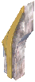 | `piece_white_marble_arch` | $piece_white_marble_arch | $piece_white_marble_arch_desc | Ice x 1 |
| 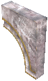 | `piece_white_marble_arch_2` | $piece_white_marble_arch_2 | $piece_white_marble_arch_2_desc | Ice x 1 |
| 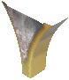 | `piece_white_marble_arch_3` | $piece_white_marble_arch_3 | $piece_white_marble_arch_3_desc | Ice x 1 |
| 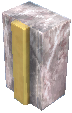 | `piece_white_marble_base` | $piece_white_marble_base | $piece_white_marble_base_desc | Ice x 1 |
| 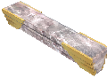 | `piece_white_marble_beam_1` | $piece_white_marble_beam_1 | $piece_white_marble_beam_1_desc | Ice x 1 |
| 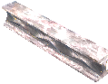 | `piece_white_marble_beam_2` | $piece_white_marble_beam_2 | $piece_white_marble_beam_2_desc | Ice x 1 |
| 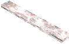 | `piece_white_marble_beam_3` | $piece_white_marble_beam_3 | $piece_white_marble_beam_3_desc | Ice x 1 |
|  | `piece_white_marble_beam_4` | $piece_white_marble_beam_4 | $piece_white_marble_beam_4_desc | Ice x 1 |
|  | `piece_white_marble_bell` | $piece_white_marble_bell | $piece_white_marble_bell_desc | Ice x 1 |
|  | `piece_white_marble_detail_1` | $piece_white_marble_detail_1 | $piece_white_marble_detail_1_desc | Ice x 1 |
|  | `piece_white_marble_brazier` | $piece_white_marble_brazier | $piece_white_marble_brazier_desc | Ice x 1 |
|  | `piece_white_marble_column_1_1` | $piece_white_marble_column_1_1 | $piece_white_marble_column_1_1_desc | Ice x 1 |
| 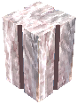 | `piece_white_marble_column_1_2` | $piece_white_marble_column_1_2 | $piece_white_marble_column_1_2_desc | Ice x 1 |
|  | `piece_white_marble_column_1_3` | $piece_white_marble_column_1_3 | $piece_white_marble_column_1_3_desc | Ice x 1 |
| 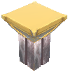 | `piece_white_marble_column_1_4` | $piece_white_marble_column_1_4 | $piece_white_marble_column_1_4_desc | Ice x 1 |
| 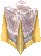 | `piece_white_marble_column_2_1` | $piece_white_marble_column_2_1 | $piece_white_marble_column_2_1_desc | Ice x 1 |
| 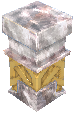 | `piece_white_marble_column_2_2` | $piece_white_marble_column_2_2 | $piece_white_marble_column_2_2_desc | Ice x 1 |
|  | `piece_white_marble_column_2_3` | $piece_white_marble_column_2_3 | $piece_white_marble_column_2_3_desc | Ice x 1 |
| 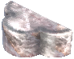 | `piece_white_marble_column_3_1` | $piece_white_marble_column_3_1 | $piece_white_marble_column_3_1_desc | Ice x 1 |
|  | `piece_white_marble_column_3_2` | $piece_white_marble_column_3_2 | $piece_white_marble_column_3_2_desc | Ice x 1 |
| 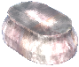 | `piece_white_marble_column_4_1` | $piece_white_marble_column_4_1 | $piece_white_marble_column_4_1_desc | Ice x 1 |
| 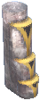 | `piece_white_marble_column_4_2` | $piece_white_marble_column_4_2 | $piece_white_marble_column_4_2_desc | Ice x 1 |
| 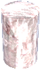 | `piece_white_marble_column_4_3` | $piece_white_marble_column_4_3 | $piece_white_marble_column_4_3_desc | Ice x 1 |
| 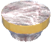 | `piece_white_marble_column_4_4` | $piece_white_marble_column_4_4 | $piece_white_marble_column_4_4_desc | Ice x 1 |
| 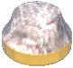 | `piece_white_marble_column_4_5` | $piece_white_marble_column_4_5 | $piece_white_marble_column_4_5_desc | Ice x 1 |
| 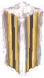 | `piece_white_marble_column_5_1` | $piece_white_marble_column_5_1 | $piece_white_marble_column_5_1_desc | Ice x 1 |
| 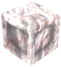 | `piece_white_marble_column_5_2` | $piece_white_marble_column_5_2 | $piece_white_marble_column_5_2_desc | Ice x 1 |
| 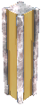 | `piece_white_marble_column_6_1` | $piece_white_marble_column_6_1 | $piece_white_marble_column_6_1_desc | Ice x 1 |
| 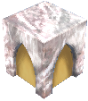 | `piece_white_marble_column_6_2` | $piece_white_marble_column_6_2 | $piece_white_marble_column_6_2_desc | Ice x 1 |
|  | `piece_white_marble_column_6_3` | $piece_white_marble_column_6_3 | $piece_white_marble_column_6_3_desc | Ice x 1 |
|  | `piece_white_marble_column_7_1` | $piece_white_marble_column_7_1 | $piece_white_marble_column_7_1_desc | Ice x 1 |
|  | `piece_white_marble_column_7_2` | $piece_white_marble_column_7_2 | $piece_white_marble_column_7_2_desc | Ice x 1 |
|  | `piece_white_marble_column_7_3` | $piece_white_marble_column_7_3 | $piece_white_marble_column_7_3_desc | Ice x 1 |
|  | `piece_white_marble_column_7_4` | $piece_white_marble_column_7_4 | $piece_white_marble_column_7_4_desc | Ice x 1 |
|  | `piece_white_marble_column_8_1` | $piece_white_marble_column_8_1 | $piece_white_marble_column_8_1_desc | Ice x 1 |
| 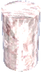 | `piece_white_marble_column_8_2` | $piece_white_marble_column_8_2 | $piece_white_marble_column_8_2_desc | Ice x 1 |
| 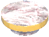 | `piece_white_marble_column_8_3` | $piece_white_marble_column_8_3 | $piece_white_marble_column_8_3_desc | Ice x 1 |
| 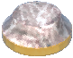 | `piece_white_marble_column_8_4` | $piece_white_marble_column_8_4 | $piece_white_marble_column_8_4_desc | Ice x 1 |
|  | `piece_white_marble_contreforce_1` | $piece_white_marble_contreforce_1 | $piece_white_marble_contreforce_1_desc | Ice x 1 |
|  | `piece_white_marble_contreforce_2` | $piece_white_marble_contreforce_2 | $piece_white_marble_contreforce_2_desc | Ice x 1 |
| 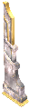 | `piece_white_marble_contreforce_2_1` | $piece_white_marble_contreforce_2_1 | $piece_white_marble_contreforce_2_1_desc | Ice x 1 |
|  | `piece_white_marble_contreforce_2_2` | $piece_white_marble_contreforce_2_2 | $piece_white_marble_contreforce_2_2_desc | Ice x 1 |
|  | `piece_white_marble_contreforce_3` | $piece_white_marble_contreforce_3 | $piece_white_marble_contreforce_3_desc | Ice x 1 |
| 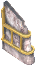 | `piece_white_marble_contreforce_3_1` | $piece_white_marble_contreforce_3_1 | $piece_white_marble_contreforce_3_1_desc | Ice x 1 |
|  | `piece_white_marble_contreforce_3_2` | $piece_white_marble_contreforce_3_2 | $piece_white_marble_contreforce_3_2_desc | Ice x 1 |
|  | `piece_white_marble_contreforce_3_3` | $piece_white_marble_contreforce_3_3 | $piece_white_marble_contreforce_3_3_desc | Ice x 1 |
|  | `piece_white_marble_contreforce_4` | $piece_white_marble_contreforce_4 | $piece_white_marble_contreforce_4_desc | Ice x 1 |
| 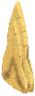 | `piece_white_marble_contreforce_5` | $piece_white_marble_contreforce_5 | $piece_white_marble_contreforce_5_desc | Ice x 1 |
| 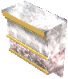 | `piece_white_marble_cornice_1` | $piece_white_marble_cornice_1 | $piece_white_marble_cornice_1_desc | Ice x 1 |
| 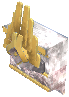 | `piece_white_marble_cornice_2` | $piece_white_marble_cornice_2 | $piece_white_marble_cornice_2_desc | Ice x 1 |
| 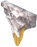 | `piece_white_marble_cornice_3` | $piece_white_marble_cornice_3 | $piece_white_marble_cornice_3_desc | Ice x 1 |
|  | `piece_white_marble_deco_1` | $piece_white_marble_deco_1 | $piece_white_marble_deco_1_desc | Ice x 1 |
|  | `piece_white_marble_deco_2` | $piece_white_marble_deco_2 | $piece_white_marble_deco_2_desc | Ice x 1 |
|  | `piece_white_marble_deco_3` | $piece_white_marble_deco_3 | $piece_white_marble_deco_3_desc | Ice x 1 |
| 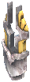 | `piece_white_marble_deco_4` | $piece_white_marble_deco_4 | $piece_white_marble_deco_4_desc | Ice x 1 |
|  | `piece_white_marble_deco_5` | $piece_white_marble_deco_5 | $piece_white_marble_deco_5_desc | Ice x 1 |
|  | `piece_white_marble_deco_6` | $piece_white_marble_deco_6 | $piece_white_marble_deco_6_desc | Ice x 1 |
|  | `piece_white_marble_deco_7` | $piece_white_marble_deco_7 | $piece_white_marble_deco_7_desc | Ice x 1 |
| 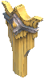 | `piece_white_marble_deco_8` | $piece_white_marble_deco_8 | $piece_white_marble_deco_8_desc | Ice x 1 |
| 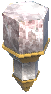 | `piece_white_marble_deco_9` | $piece_white_marble_deco_9 | $piece_white_marble_deco_9_desc | Ice x 1 |
|  | `piece_white_marble_deco_10` | $piece_white_marble_deco_10 | $piece_white_marble_deco_10_desc | Ice x 1 |
| 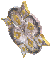 | `piece_white_marble_flat_1` | $piece_white_marble_flat_1 | $piece_white_marble_flat_1_desc | Ice x 1 |
| 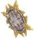 | `piece_white_marble_flat_2` | $piece_white_marble_flat_2 | $piece_white_marble_flat_2_desc | Ice x 1 |
| 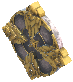 | `piece_white_marble_flat_3` | $piece_white_marble_flat_3 | $piece_white_marble_flat_3_desc | Ice x 1 |
| 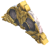 | `piece_white_marble_flat_4` | $piece_white_marble_flat_4 | $piece_white_marble_flat_4_desc | Ice x 1 |
| 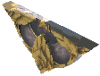 | `piece_white_marble_flat_5` | $piece_white_marble_flat_5 | $piece_white_marble_flat_5_desc | Ice x 1 |
|  | `piece_white_marble_pillar_1` | $piece_white_marble_pillar_1 | $piece_white_marble_pillar_1_desc | Ice x 1 |
| 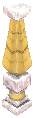 | `piece_white_marble_pillar_2` | $piece_white_marble_pillar_2 | $piece_white_marble_pillar_2_desc | Ice x 1 |
| 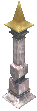 | `piece_white_marble_pillar_3` | $piece_white_marble_pillar_3 | $piece_white_marble_pillar_3_desc | Ice x 1 |
| 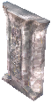 | `piece_white_marble_wall_1` | $piece_white_marble_wall_1 | $piece_white_marble_wall_1_desc | Ice x 1 |
|  | `piece_white_marble_wall_2` | $piece_white_marble_wall_2 | $piece_white_marble_wall_2_desc | Ice x 1 |
| 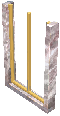 | `piece_white_marble_window_1_1` | $piece_white_marble_window_1_1 | $piece_white_marble_window_1_1_desc | Ice x 1 |
| 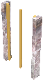 | `piece_white_marble_window_1_2` | $piece_white_marble_window_1_2 | $piece_white_marble_window_1_2_desc | Ice x 1 |
|  | `piece_white_marble_window_1_3` | $piece_white_marble_window_1_3 | $piece_white_marble_window_1_3_desc | Ice x 1 |
|  | `piece_white_marble_window_1_4` | $piece_white_marble_window_1_4 | $piece_white_marble_window_1_4_desc | Ice x 1 |
|  | `piece_white_marble_window_1_5` | $piece_white_marble_window_1_5 | $piece_white_marble_window_1_5_desc | Ice x 1 |
|  | `piece_white_marble_window_2_1` | $piece_white_marble_window_2_1 | $piece_white_marble_window_2_1_desc | Ice x 1 |
|  | `piece_white_marble_window_2_2` | $piece_white_marble_window_2_2 | $piece_white_marble_window_2_2_desc | Ice x 1 |
|  | `piece_white_marble_window_2_3` | $piece_white_marble_window_2_3 | $piece_white_marble_window_2_3_desc | Ice x 1 |
|  | `piece_white_marble_window_2_4` | $piece_white_marble_window_2_4 | $piece_white_marble_window_2_4_desc | Ice x 1 |
| 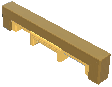 | `piece_white_marble_window_2_5` | $piece_white_marble_window_2_5 | $piece_white_marble_window_2_5_desc | Ice x 1 |
|  | `piece_white_marble_window_3_1` | $piece_white_marble_window_3_1 | $piece_white_marble_window_3_1_desc | Ice x 1 |
|  | `piece_white_marble_window_3_2` | $piece_white_marble_window_3_2 | $piece_white_marble_window_3_2_desc | Ice x 1 |
|  | `piece_white_marble_window_3_3` | $piece_white_marble_window_3_3 | $piece_white_marble_window_3_3_desc | Ice x 1 |
| 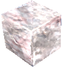 | `piece_white_marble_1x1` | $piece_white_marble_1x1 | $piece_white_marble_1x1_desc | Ice x 1 |
| 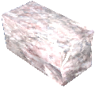 | `piece_white_marble_2x1x1` | $piece_white_marble_2x1x1 | $piece_white_marble_2x1x1_desc | Ice x 1 |
| 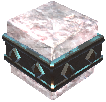 | `piece_white_marble_2x2_enforced` | $piece_white_marble_2x2_enforced | $piece_white_marble_2x2_enforced_desc | Ice x 1 |
| 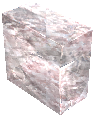 | `piece_white_marble_2x2x1` | $piece_white_marble_2x2x1 | $piece_white_marble_2x2x1_desc | Ice x 1 |
| 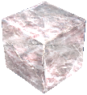 | `piece_white_marble_2x2x2` | $piece_white_marble_2x2x2 | $piece_white_marble_2x2x2_desc | Ice x 1 |
|  | `piece_white_marble_arch_1` | $piece_white_marble_arch_1 | $piece_white_marble_arch_1_desc | Ice x 1 |
| 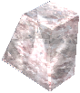 | `piece_white_marble_base_1` | $piece_white_marble_base_1 | $piece_white_marble_base_1_desc | Ice x 1 |
|  | `piece_white_marble_base_2` | $piece_white_marble_base_2 | $piece_white_marble_base_2_desc | Ice x 1 |
|  | `piece_white_marble_base_corner` | $piece_white_marble_base_corner | $piece_white_marble_base_corner_desc | Ice x 1 |
|  | `piece_white_marble_column_1` | $piece_white_marble_column_1 | $piece_white_marble_column_1_desc | Ice x 1 |
|  | `piece_white_marble_column_2` | $piece_white_marble_column_2 | $piece_white_marble_column_2_desc | Ice x 1 |
|  | `piece_white_marble_column_3` | $piece_white_marble_column_3 | $piece_white_marble_column_3_desc | Ice x 1 |
|  | `piece_white_marble_floor` | $piece_white_marble_floor | $piece_white_marble_floor_desc | Ice x 1 |
|  | `piece_white_marble_floor_triangle` | $piece_white_marble_floor_triangle | $piece_white_marble_floor_triangle_desc | Ice x 1 |
|  | `piece_white_marble_out_1` | $piece_white_marble_out_1 | $piece_white_marble_out_1_desc | Ice x 1 |
|  | `piece_white_marble_out_2` | $piece_white_marble_out_2 | $piece_white_marble_out_2_desc | Ice x 1 |
|  | `piece_white_marble_outcorner` | $piece_white_marble_outcorner | $piece_white_marble_outcorner_desc | Ice x 1 |
|  | `piece_white_marble_slope_1x2` | $piece_white_marble_slope_1x2 | $piece_white_marble_slope_1x2_desc | Ice x 1 |
|  | `piece_white_marble_slope_inverted_1x2` | $piece_white_marble_slope_inverted_1x2 | $piece_white_marble_slope_inverted_1x2_desc | Ice x 1 |
|  | `piece_white_marble_stair` | $piece_white_marble_stair | $piece_white_marble_stair_desc | Ice x 1 |
|  | `piece_white_marble_tile_floor_1x1` | $piece_white_marble_tile_floor_1x1 | $piece_white_marble_tile_floor_1x1_desc | Ice x 1 |
|  | `piece_white_marble_tile_floor_2x2` | $piece_white_marble_tile_floor_2x2 | $piece_white_marble_tile_floor_2x2_desc | Ice x 1 |
|  | `piece_white_marble_tile_wall_1x1` | $piece_white_marble_tile_wall_1x1 | $piece_white_marble_tile_wall_1x1_desc | Ice x 1 |
|  | `piece_white_marble_tile_wall_2x2` | $piece_white_marble_tile_wall_2x2 | $piece_white_marble_tile_wall_2x2_desc | Ice x 1 |
|  | `piece_white_marble_tile_wall_2x4` | $piece_white_marble_tile_wall_2x4 | $piece_white_marble_tile_wall_2x4_desc | Ice x 1 |
|  | `piece_white_marble_tip` | $piece_white_marble_tip | $piece_white_marble_tip_desc | Ice x 1 |
